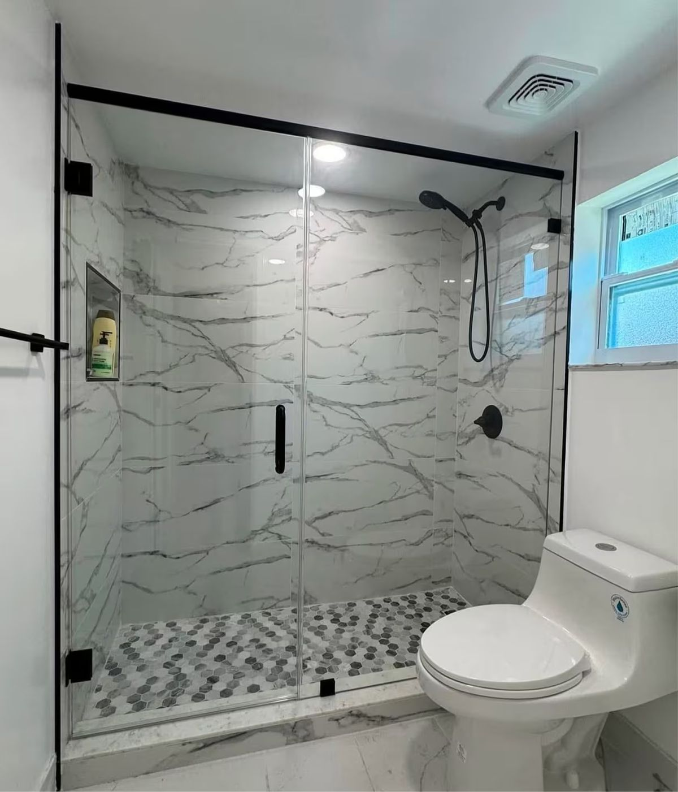

<div align="center">


# WS Flooring LLC

**Tile, marble & bathroom remodeling.**

Uma experiência digital dedicada ao cuidado com cada acabamento.
Charleston, South Carolina.


[Homologação](https://wsflooring.escolats.com.br) · [Começar](#executar-localmente) · [Publicação](#publicação) · [Pendências](#antes-do-lançamento)

<br>



<sub>Texturas, materiais e projetos como protagonistas.</sub>

</div>

---

## O projeto

Site institucional de página única para a **WS Flooring LLC**, empresa de instalação de revestimentos, mármore e reforma de banheiros na região de Charleston. A navegação apresenta os serviços, mostra projetos e conduz o visitante ao pedido de orçamento.

O site é escrito em inglês para o público americano. Esta documentação acompanha a manutenção do projeto em português.

## Experiência

| Elemento | Implementação |
| --- | --- |
| **Direção visual** | Superfícies de mármore, tons neutros, detalhes em bronze e tipografia Kumbh Sans. |
| **Serviços** | Bathroom Remodeling, Custom Tile & Backsplash e Marble Flooring. |
| **Portfólio** | Galeria contínua com visualização ampliada e miniaturas. |
| **Processo em 3D** | Animação vinculada à rolagem: preparação, paginação, assentamento, rejunte e acabamento. |
| **Orçamentos** | Formulário em três etapas, validação e proteção antispam no navegador. Integração de envio pendente. |
| **Contato** | Links de telefone e e-mail, com atalhos para dispositivos móveis. |
| **Movimento** | Tratamento da preferência `prefers-reduced-motion`. |
| **Busca e compartilhamento** | Metadados, dados estruturados JSON-LD, sitemap, robots e manifest. Há ajustes de lançamento listados abaixo. |

## Tecnologia

**HTML, CSS e JavaScript puro**, sem gerenciador de pacotes ou etapa de compilação. Fontes, imagens e Three.js são servidos pelo próprio projeto; a biblioteca 3D é carregada quando sua seção se aproxima da área visível.

- **Imagens:** AVIF com alternativas em JPEG e tamanhos responsivos.
- **Servidor de destino:** Apache, com regras em `.htaccess` para HTTPS, URLs limpas, compressão, cache e cabeçalhos.
- **Formulário:** integração preparada com Web3Forms e cópia opcional para um webhook.
- **Medição:** eventos `click_call`, `click_email` e `generate_lead` enviados ao `dataLayer`; ferramentas de analytics ainda precisam ser conectadas.
- **PHP:** usado apenas pelo utilitário `clean-cache.php`.

## Executar localmente

Com Git e Python 3 instalados:

```bash
git clone https://github.com/PedroAgostini/WS-FLOORING.git
cd WS-FLOORING
python -m http.server 8080 --bind 127.0.0.1
```

Abra **http://127.0.0.1:8080**. Use um servidor HTTP para que os módulos da seção 3D carreguem corretamente.

O servidor do Python permite visualizar o frontend, mas não executa PHP nem interpreta `.htaccess`. Para validar redirecionamentos, cabeçalhos, URLs limpas e o utilitário de cache, use Apache com PHP e suporte às diretivas necessárias.

## Estrutura

```text
WS-FLOORING/
├── index.html              # Página, conteúdo, SEO e formulário
├── assets/
│   ├── css/styles.css      # Estilos e comportamento responsivo
│   ├── js/
│   │   ├── main.js         # Navegação, galeria, formulário e eventos
│   │   ├── steps3d.js      # Cena e etapas de instalação em Three.js
│   │   └── antispam.js     # Proteção do formulário no navegador
│   ├── vendor/three/       # Three.js servido localmente
│   ├── fonts/              # Fonte em WOFF2
│   ├── img/                # Projetos, texturas e imagens de apoio
│   └── logo/               # Marca em SVG
├── .htaccess               # Configuração do Apache
├── clean-cache.php         # Limpeza de cache e storage do navegador
├── site.webmanifest        # Metadados e ícones da aplicação
├── robots.txt              # Instruções para rastreadores
├── sitemap.xml             # Mapa de URLs
├── humans.txt              # Informações do projeto
└── llms.txt                # Resumo textual do negócio
```

Configurações de ferramentas locais, documentos internos e explorações de design ficam fora do versionamento por meio do `.gitignore`.

## Configurar o formulário

Em `index.html`, localize `#quote-form`:

1. Preencha o campo oculto `access_key` com a chave de integração do Web3Forms.
2. Se houver recebimento de leads pela agência, preencha `data-lead-webhook` com o endpoint apropriado.
3. Teste um envio real em homologação e confirme o recebimento antes do lançamento.

Sem a chave, o formulário informa que ainda não está conectado e oferece telefone e e-mail como alternativas. A cópia para o webhook acontece após o sucesso do Web3Forms; falhas dessa cópia não impedem a confirmação ao visitante.

Os valores presentes no HTML são públicos. Credenciais privadas de serviços devem permanecer no servidor.

## Publicação

| Ambiente | Endereço | Papel |
| --- | --- | --- |
| Homologação | https://wsflooring.escolats.com.br | Revisão do projeto; `.htaccess` configura `noindex, nofollow` para esse host. |
| Domínio final previsto | https://wsflooringtile.com | Destino da substituição do site anterior. O push para o GitHub não publica nesse domínio. |

Envie `index.html`, `assets/`, `.htaccess`, `clean-cache.php`, ícones e arquivos públicos de metadados para a raiz do site no Apache. Inclua as páginas complementares quando estiverem implementadas.

Após alterar CSS ou JavaScript, atualize os parâmetros `?v=` das referências no HTML e, quando necessário, da importação de `steps3d.js` em `main.js`, pois esses recursos usam cache prolongado.

O endpoint `/clean-cache` envia o cabeçalho `Clear-Site-Data` para limpar cache e storage no navegador que o acessa, conforme o suporte do navegador e em HTTPS. Ele não limpa o cache da hospedagem ou de uma CDN.

## Antes do lançamento

O repositório registra a implementação atual. Os seguintes itens ainda precisam de conclusão ou validação:

- [ ] Conectar Web3Forms e, se aplicável, o webhook de leads.
- [ ] Configurar os IDs de analytics e publicidade e validar as conversões.
- [ ] Substituir os três exemplos de reviews, identificados como fictícios no site, por depoimentos reais aprovados, com autor, data e fonte.
- [ ] Confirmar as fotos definitivas e aprovar o conteúdo do FAQ.
- [ ] Criar as páginas de privacidade, termos de serviço e erro 404, já referenciadas pelo projeto.
- [ ] Adicionar `assets/img/og-ws-flooring.jpg`, referenciada nos metadados sociais.
- [ ] Ajustar as referências a `assets/icons/favicon.svg` e `assets/icons/icon-512.png`, cujos arquivos não estão presentes nesses caminhos.
- [ ] Alinhar sitemap e demais referências de domínio para o ambiente de produção.
- [ ] Completar os redirecionamentos das URLs do antigo WordPress em `.htaccess`.
- [ ] Validar navegação, formulário, 3D, links e regras do Apache em dispositivos móveis e desktop.

---

<div align="center">
<strong>WS Flooring LLC</strong><br>
<sub>Hanahan · Greater Charleston · South Carolina</sub>
</div>
